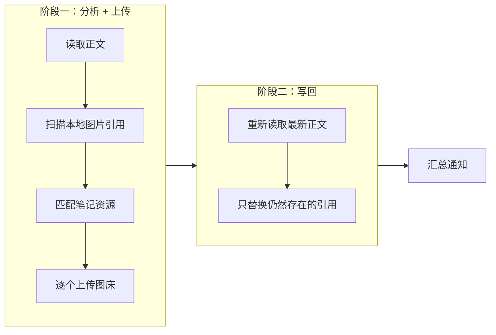

EdgeEver 的图片默认存放在笔记自身的服务器上。时间一长，你难免会想把这些存量图片搬到**自己掌控的图床**上，摆脱对单一服务器的依赖。「图床迁移」（ImgBed Migrator）就是为这个场景写的 EdgeEver 插件：扫描笔记里的本地图片，上传到 CloudFlare ImgBed，再把正文引用替换成可访问的外链。

它的定位很清晰：**图片已经成为笔记附件之后**，负责把它搬到图床并改好引用，而不是去篡改 EdgeEver 本身的上传流程。哪些能做到、哪些做不到，下文如实说明。

:::link-card
---
icon: https://github.com/favicon.ico
title: zylunx/edgeever-imgbed-plugin
description: 插件仓库，根目录即最新构建产物
link: https://github.com/zylunx/edgeever-imgbed-plugin
---
:::

## 功能特性

手动上传、自动上传、本地直传、记录复用、备份恢复、删除清理、失败安全——七项能力全部可开关：

| 特性 | 说明 |
| :--- | :--- |
| 手动上传当前笔记 | 扫描正文中的本地图片 → 上传图床 → 替换为 ``，并给出汇总通知（新上传、复用、替换、未匹配各几处） |
| 保存后自动上传 | 监听 `note.updated` 事后处理，可限定「仅当前笔记」或「所有更新的笔记」，内置防循环 |
| 本地文件直传 | 管理面板里选本机文件直传图床，这条路径确实不经过 EdgeEver 服务器 |
| 上传记录复用 | 同一资源只传一次，不重复上传、不重复占用图床空间 |
| 替换前自动备份 | 默认开启，配一条「恢复备份」命令，随时回滚到迁移前 |
| 删除本地资源 | 可选删除 EdgeEver 本地附件；开启同步删除时，连图床文件一起清掉 |
| 失败安全 | 任何一步失败都不改写正文，只在通知里报告，绝不把笔记写坏 |

## 工作原理

每篇笔记走**两阶段处理**，刻意避开「边传边改」的坑：上传是网络耗时操作，期间你还能继续编辑；写回前重新读取正文，只替换仍然存在的引用，避免覆盖你的并发编辑。

图床侧是一个完整的 CloudFlare ImgBed 客户端：

- 三种鉴权：API Token（Bearer）、上传认证码（`authCode` 查询参数）、无鉴权；
- 支持 `returnFormat`、`uploadChannel`、`channelName`、`uploadNameType`、`uploadFolder`、`serverCompress` 等参数；
- 上传接口返回数组 `[{ src, publicUrl }]`，插件**优先采用 `publicUrl`**（即你配置的 CDN 前缀），否则用 `src` 拼接站点地址，最终得到一个干净的绝对 URL。

本地引用怎么识别？EdgeEver 没有公开笔记里本地图片的具体引用语法，插件采用「通用扫描（`` 与 `![[target]]`）+ 资源匹配（ID 包含 / 文件名 / 去扩展名相等）」策略，并留了一个 `local-ref-pattern` 正则兜底，你可以精确指定哪些引用算本地图片。

::alert{type="info" title="建议先实测再开自动"}
引用语法毕竟是推断出来的。安装后先拿一篇含图的笔记跑一次「上传当前笔记」，从汇总通知里确认匹配情况，再决定是否开启自动上传。
::

## 安装与配置

1. 拿到三件套：`manifest.json`、`main.js`、`styles.css`，仓库根目录即最新构建产物，插件 ID 为 `com.zylunx.edgeever-imgbed`；
2. 在 EdgeEver 里用**本地 manifest 地址**安装 / 调试插件；
3. 到图床「管理界面 → 系统设置 → 安全设置 → API Token 管理」生成一个带 `upload` 权限的 Token，如需同步删除图床文件，再加 `delete`；
4. 打开插件设置，填「图床站点地址」、选鉴权方式、填 Token 或认证码，按需打开各个开关；
5. 先手动跑一次「上传当前笔记」验证匹配情况，再考虑开启自动上传。

设置项共 16 个，按用途分成四组，下表将相关项合并展示，全部可开关：

| 分类 | 设置 | 说明 |
| :--- | :--- | :--- |
| 连接 | 图床站点地址 | 你的 ImgBed 地址，如 `https://img.example.com` |
| 连接 | 鉴权方式 / Token / 认证码 | Bearer Token、上传认证码或无鉴权 |
| 上传 | 返回链接格式 | 完整链接或 `/file/` 路径 |
| 上传 | 上传渠道 / 渠道名称 | telegram / cfr2 / s3 / discord / huggingface / webdav |
| 上传 | 文件命名方式 / 上传目录 | default / index / origin / short；目录默认 `edgeever` |
| 上传 | 服务端压缩 | 仅 Telegram 渠道图片生效 |
| 上传 | 单文件大小上限 | 默认 20MB，`0` 不限；超限跳过 |
| 行为 | 保存后自动上传 + 范围 | 事后处理，可限定当前 / 所有笔记，带防循环 |
| 行为 | 替换成功后删除本地资源 | 开关 |
| 行为 | 删除本地时同步删除图床文件 | 需带 `delete` 权限的 Token |
| 行为 | 替换前自动备份 | 默认开启 |
| 行为 | 同时上传非图片附件 | 默认关闭；开启后 PDF 等以链接形式写入 |
| 高级 | 本地引用识别规则（正则） | 留空则自动识别 |
| 高级 | Markdown 链接模板 | 默认 ``，支持 `{alt}` `{url}` `{name}` |

## 能力边界

诚实地说清楚哪些做不到、哪些有限制，比堆功能更重要。

::alert{type="warning" title="做不到「上传前拦截」"}
插件 API 没有任何「上传前拦截」钩子，事件也只有 note / tag / sync / settings 几类；图片进入 EdgeEver 服务器这一步由宿主独占，插件无法旁路。所以自动上传是「保存后替换」的事后方案，而「本地文件直传」才是不经 EdgeEver 的真正直连通道。
::

其余限制如下：

- **本地图片引用语法靠推断**：EdgeEver 未公开该语法，插件用「通用扫描 + 资源匹配 + 正则兜底」；安装后建议先用一篇含图笔记实测，通知里会报告匹配情况，若有出入可调整 `local-ref-pattern`；
- **未实现分块上传**：超过「单文件大小上限」（默认 20MB）的文件会跳过并提示，更大文件需要图床的 initChunked / chunked / merge 三步流程，已列入路线图；
- **移动端不运行插件，设置仅存本机。**

## 附件支持说明

- **图片**（png / jpg / gif / webp / svg 等）完全支持，正常嵌入显示；
- **其他文件**（PDF、压缩包等）本质是图床、以图片最佳；开启「同时上传非图片附件」后也能传，并会以**链接语法** `[alt](url)` 写入笔记，而不是图片语法，否则会在 Markdown 里渲染成裂图；
- 附件大小同样受渠道限制（如 Telegram 单文件 20MB）。

## 技术与质量

- **TypeScript 严格模式**编写，**esbuild** 打包成单文件 ESM `main.js`（约 49KB，远低于插件体积上限）；
- 用一套 **Mock 宿主环境**跑了 **20 项冒烟测试**，覆盖开关守卫、防循环、上传失败不回写、`publicUrl` 优先、大小上限、两种鉴权、备份恢复、附件链接语法等边界；
- 开发过程中严格遵循「**不贸然开发、无法实现就写进说明文档**」的原则，所有已知边界都记录在仓库的《未实现功能说明.md》中。

## 后续路线

- 分块上传（对齐图床 initChunked / chunked / merge 流程），突破单文件 20MB 限制；
- 实测校准 EdgeEver 的资源字段与本地图片引用语法，收紧匹配策略；
- 视需要适配更多图床后端。

## 小结

插件的价值在于把「迁移」这件事做得可回滚、可开关、不误伤；而平台能力所限的「上传前拦截」，它选择如实说明，并给出「本地文件直传」这条真正直连的替代通道。

:quote[如果你想把 EdgeEver 的图片迁到自己掌控的 CloudFlare ImgBed 上，又要可回滚、可开关、不误伤——这个插件就是干这件事的。]
