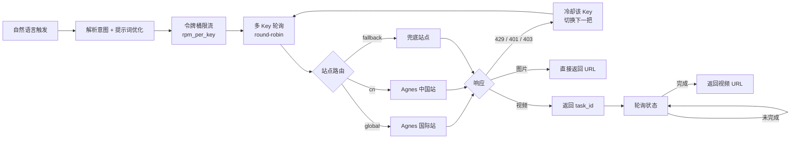

Agnes AI 提供了一套走 OpenAI 兼容协议的免费全模态模型，能文生图、文生视频、图生视频。一句话就能触发——「生成一张图片 / 出个图 / 做个视频 / 图生视频」，Skill 就会被唤起。

但免费额度下直接裸调接口，有几个绕不开的现实痛点：**图片接口限流严格，单把 Key 很容易撞上 429；国际站和中国站的 Key 不能混用，否则直接 401；一次要出好几张时，更是分分钟把 RPM 打爆。** 这个 Skill 把多 Key 轮询、令牌桶限流、自动故障转移、异步轮询这些工程细节全部消化掉，让你用一句自然语言就能批量出图、出视频，而不是先去写一坨调度代码。

## :::link-card

icon: <https://github.com/favicon.ico>  
title: Agnes AI 全模态模型  
description: OpenAI 兼容协议，免费额度下的文生图 / 文生视频 / 图生视频能力  
link: <https://agnes.ai>
------------------------

:::

## 它解决了什么

免费额度下的「出图出视频」，真正的难点不在调接口，而在工程侧：

- **限流严**：图片 API 对单 Key 的请求频率卡得很死，稍不留神就 429；
- **Key 易失效**：单把 Key 一旦被限，后续请求全部失败；
- **站点不能混用**：国际站（`global`）和中国站（`cn`）的 Key 互不相通，用错站点立刻 401；
- **批量会爆 RPM**：想一次出 5 张、10 张，瞬时并发直接把每分钟请求数打穿。

这个 Skill 用 **多 Key 轮询 + 令牌桶限流 + 自动故障转移 + 异步轮询** 把上述细节全部封装掉。你只管描述想要什么，剩下的排队、冷却、切换、轮询都由它处理，并实时回报进度。

## 核心能力

- **多 Key 轮询（round-robin）**：用逗号或列表配置多个 Key，请求均摊；遇到 `429 / 401 / 403` 自动冷却并切换到下一把 Key。
- **单 Key RPM 令牌桶限流**：批量生成时自动排队等待，绝不瞬间打爆接口，并实时回报进度。
- **国际站 / cn 站 / fallback 站点**：可配置，且**每把 Key 可单独指定站点**（用 `cn:sk-xxx` 前缀标注）。
- **生图前提示词优化**：负责真正的语义优化，脚本侧另提供 `--enhance` 本地兜底补强。
- **缺信息主动提问**：未说明风格 / 画幅 / 数量 / 运镜时，用 `AskUserQuestion` 主动澄清，而不是瞎猜。
- **默认推荐模型 + free 额度保守默认**：`agnes-image-2.1-flash` / `agnes-video-v2.0`，`rpm_per_key=3` 等均可配。
- **视频两阶段异步**：提交 → 拿到 `task_id` → 轮询状态 → 返回 URL，且 task 会绑定创建它的那把 Key。

## 文件结构

Skill 本体非常轻，核心客户端只用 Python 标准库，零第三方依赖：

```
agnes/
├── SKILL.md                      # 触发词 + 工作流
├── scripts/agnes_client.py       # 核心客户端（仅标准库）
├── references/api.md             # Agnes API 契约（站点 / 模型 / 请求响应）
├── references/prompt_guidelines.md  # 提示词优化 + 风格澄清清单
└── assets/config.example.json    # 配置样例
```

## 架构：一次请求是怎么被消化的

从你的一句话，到最终拿到图片或视频 URL，中间经过这样一条链路——重点在于「轮询 + 限流 + 故障转移」这一环把抖动全部吸收掉：



## 配置：Key / 站点 / 模型 / RPM / 清晰度

配置默认存放在 `~/skills/agnes/config.json`，也可以用环境变量 `AGNES_API_KEY` / `AGNES_API_KEYS` / `AGNES_SITE` 覆盖。

```bash
# 添加 Key（国际站直写；cn 站用 cn: 前缀单独指定站点）
python ~/skills/agnes/scripts/agnes_client.py config \
  --add-key "sk-xxx" --add-key "cn:sk-cn-xxx"

# 切换默认站点 / 模型 / RPM / 尺寸
python ~/skills/agnes/scripts/agnes_client.py config --set-site cn
python ~/skills/agnes/scripts/agnes_client.py config --set-rpm 3 --set-size 1344x768
```

关键字段一览，绝大多数都能按你的额度情况调整：

| 字段                             | 默认值                     | 说明                                  |
| :----------------------------- | :---------------------- | :---------------------------------- |
| `site`                         | `global`                | 全局默认站点：`global` / `cn` / `fallback` |
| `keys`                         | —                       | 支持每把 Key 单独指定站点（如 `cn:sk-cn-xxx`）   |
| `model_image`                  | `agnes-image-2.1-flash` | 默认推荐生图模型                            |
| `model_video`                  | `agnes-video-v2.0`      | 默认推荐生视频模型                           |
| `rpm_per_key`                  | `3`                     | 单 Key 每分钟请求数（令牌桶容量）                 |
| `image_size`                   | `1024x1024`             | 默认生图尺寸                              |
| `key_cooldown_secs`            | `600`                   | 遇 `401 / 403` 时该 Key 冷却时长           |
| `key_rate_limit_cooldown_secs` | `60`                    | 遇 `429` 时该 Key 冷却时长                 |
| `video_poll_interval_secs`     | `5`                     | 视频任务轮询间隔                            |
| `video_deadline_secs`          | `480`                   | 视频任务最长等待时间                          |

::alert{type="warning" title="Key 与站点必须匹配"}  
每把 Key 的归属站点必须和它实际调用时用的站点一致，否则会返回 401。当你混合使用不同站点的 Key 时，**务必用 `cn:` 前缀标注清楚**，否则轮询到错误站点会直接失败。  
::

## 使用

### 文生图 / 批量生图

批量时自动跨 Key 轮询，并按 RPM 排队，不用你手动控速：

```bash
python ~/skills/agnes/scripts/agnes_client.py image "<优化后的英文提示词>" \
  --count 5 --size 1024x1024 --style "anime style" --save
```

### 文生视频 / 图生视频

视频走两阶段异步：提交后拿到 `task_id`，客户端自动轮询到完成再返回 URL：

```bash
python ~/skills/agnes/scripts/agnes_client.py video "<优化后的英文视频提示词>" \
  --width 1152 --height 768 --num-frames 121 --frame-rate 24 --save
# 图生视频：追加 --image "<图片URL>"
```

生成之前，Skill 会先展示优化后的提示词供你确认；如果检测到还没配置 Key，会**友好提醒并停止，不会贸然去发起请求**——这点很关键，避免空跑浪费额度。

## 获取、安装与源码

这个 Skill 已经发布到 SkillHub —— 国内优先的 Skill 商店，搜索 / 安装都走国内源，更快也更合规。Skill 页面长这样：

## :::link-card

icon: <https://skillhub.cn/favicon.ico>  
title: agnes生图生视频 @ SkillHub  
description: 作者 碧云无渡 · v1.0.0 · AI 评分 4.6 · 安全无风险  
link: <https://skillhub.cn/skills/user_3ab9b44e/agents-img-make>
----------------------------------------------------------------

:::

### 安装方式一：把提示词发给你的 AI（推荐，零配置）

SkillHub 支持「让 AI 自己读安装文档并安装」。你只需把下面这句话发给你的 Agent（WorkBuddy / Claude Code / Cursor 等任意支持 skills 的客户端），它会按文档自动完成安装，不用你手动下载、解压、放路径：

```text
请根据 https://skillhub.cn/install/skillhub.md，安装 @user_3ab9b44e/agents-img-make。
```

你的 AI 会读取 `skillhub.md` 里的安装流程，把 Skill 装进当前 Agent 的 skills 目录。这也是 SkillHub 页面上「将提示词发送给你的 AI 安装该 skills」给出的官方安装口令。

### 安装方式二：SkillHub CLI（适合命令行 / 批量）

如果想用命令行装，先装 CLI，再**用 `--dir` 指定当前 Agent 的 skills 目录**（不指定的话默认装到 `./skills/`，不会被识别）：

```bash
# 安装 SkillHub CLI（CLI + 默认 Skill）
curl -fsSL https://skillhub-1388575217.cos.ap-guangzhou.myqcloud.com/install/install.sh | bash

# 装到 WorkBuddy 的 skills 目录
skillhub install @user_3ab9b44e/agents-img-make --dir ~/.workbuddy/skills/
```

常用客户端的 skills 目录：WorkBuddy `~/.workbuddy/skills/`、Claude Code `~/.claude/skills/`、Cursor `~/.cursor/skills/`、Codex `~/.codex/skills/`。

### 源码包（备选）

如果你更想直接拿源码本地部署，完整源码与配置样例也打包在下方链接，下载后放进 `~/skills/agnes/` 即可：

## :::link-card

icon: <https://pan.ezv.cc/favicon.ico>  
title: Agnes Skill 源码包（含 SKILL.md / 客户端 / API 契约）  
description: 核心客户端仅用标准库，零第三方依赖，可直接落地使用  
link: <https://pan.ezv.cc/v/67ad442b821feaab58b4f2d336052aa3>
-------------------------------------------------------------

:::
