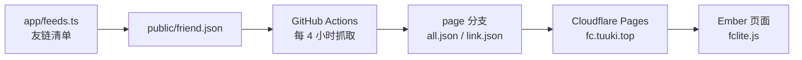

`/link` 页能说清「谁链接了我」，说不清「他们最近在写什么」。友链卡片是静态的，想知道对面的新文章，要么一个个点过去，要么等他把 RSS 塞进你的阅读器。

友链朋友圈解决的就是这件事：把友链站点最近的更新汇成一页。本文用的是 **Friend-Circle-Lite**——无后端、无数据库，靠 GitHub Actions 定时爬取，产物是一堆静态 JSON，前端只有两个文件。起点是清羽飞扬（LiuShen）的[《Friend-Circle-Lite: 轻量友链朋友圈》](https://blog.liushen.fun/posts/4dc716ec)，那篇讲的是通用流程；下面记录本站从零落地的全过程，步骤按本站的实际结构改过：友链清单来自 `app/feeds.ts`，爬取产物托管在 Cloudflare，前端接进 Ember 的页面、侧栏与明暗模式。

:::link-card
---
icon: https://github.com/favicon.ico
title: willow-god/Friend-Circle-Lite
description: 无后端的精简版友链朋友圈，兼容 fc 通用格式
link: https://github.com/willow-god/Friend-Circle-Lite
---
:::

## 它长什么样

整条链路里没有服务器，也没有数据库，只有三个角色：



- **爬取端**：Actions 定时跑一个 Python 脚本，按友链清单抓取各站 RSS，结果写进 `all.json`（文章）、`link.json`（可达性）、`errors.json`（异常站点），然后把这些文件连同前端资源一起强推到 `page` 分支；
- **数据端**：`page` 分支就是一个纯静态站，交给 Cloudflare Pages 托管；
- **展示端**：博客页面放一个空容器，引入 `fclite.js`，它自己去拉 `all.json` 并渲染卡片。

| 维度 | 说明 |
| :--- | :--- |
| 成本 | GitHub Actions 免费额度 + Cloudflare Pages 免费层，个人站够用 |
| 体积 | 前端 `fclite.js` + `fclite.css` 各约 12KB，不影响博客首屏 |
| 数据 | 全静态 JSON，没有数据库，想搬走直接 `git clone` `page` 分支 |
| 延迟 | 抓取是定时的，文章不是实时出现，本站设置的是每 4 小时一次 |
| 线路 | 抓取跑在 GitHub 的机器上（境外），部分国内站点可能抓不到，见第六节 |

::alert{type="warning" title="先说清楚边界"}
前端是**客户端渲染**的：页面里的容器是空的，数据由浏览器拿着 `all.json` 现场渲染。所以搜索引擎看不到文章列表，数据新鲜度也完全取决于上游抓取。这一点后面第五节会给出取舍建议。
::

## 一、友链清单：从 `app/feeds.ts` 生成 friend.json

上游只认一种输入：一个 JSON 文件，根对象里必须有 `friends` 数组，每一项是 `[名称, 站点地址, 头像]`（也兼容 `[名称, 站点地址, 友链页, 头像]` 和对象写法）。

```json [friend.json]
{
  "friends": [
    ["纸鹿本鹿", "https://blog.zhilu.site/", "https://www.zhilu.site/api/avatar.png"],
    ["张洪Heo", "https://blog.zhheo.com/", "https://p.zhheo.com/70UxC320590881724049185405.png!cover"]
  ]
}
```

本站的友链只有一个真源：`app/feeds.ts`。手写第二份清单必然会漂移，所以直接由它生成。新建 `scripts/framework/gen-friend-json.ts`：

```ts [scripts/framework/gen-friend-json.ts]
#!/usr/bin/env node

import { mkdirSync, writeFileSync } from 'node:fs'
import { dirname, resolve } from 'node:path'
import process from 'node:process'
import { entries } from './utils'

/** [站点名称, 站点地址, 头像地址] */
type FriendItem = [string, string, string]

const friends: FriendItem[] = entries.flatMap(entry =>
	entry.avatar ? [[entry.author, entry.link, entry.avatar]] : [],
)

const target = resolve('public/friend.json')
mkdirSync(dirname(target), { recursive: true })
writeFileSync(target, `${JSON.stringify({ friends }, null, '\t')}\n`)

console.info(`✅ 已生成 ${target}，共 ${friends.length} 条友链`)
process.exit(0)
```

`entries` 是 `scripts/framework/utils.ts` 里已经摊平好的友链列表，复用它就不用再写一遍遍历分组的逻辑。再往 `package.json` 加一条脚本：

```json [package.json]
{
  "scripts": {
    "sync:friend": "unrun scripts/framework/gen-friend-json.ts"
  }
}
```

```bash
pnpm sync:friend
```

生成的文件落在 `public/` 下，它会随 `pnpm generate` 一起进构建产物，部署后即可通过 `https://blog.tuuki.top/friend.json` 访问——**爬虫只认在线地址**，`json_url` 里写本地路径是不行的，所以这一步要先跑通再进第二节。

几个取舍说明：

- **`name` 用 `author`**：朋友圈里展示的是「人」，与本站友链卡片一致；想按站点名展示，把 `entry.author` 换成 `entry.sitenick ?? entry.author` 即可。注意改动后 `specific_RSS` 的 `name` 也要跟着改；
- **没有头像的条目直接跳过**：缺头像的卡片在朋友圈里很难看，不如不收录；
- **每次改完友链记得重跑**：也可以挂到 CI 里，但一年改不了几次友链，手动跑更省事。

## 二、Fork 仓库并把 Action 跑起来

1. Fork 上游仓库，**只保留 `main` 分支**；
2. 进 fork 后的仓库 → `Actions` → 启用工作流（fork 默认不自动运行）；
3. `Settings` → `Actions` → `General` → `Workflow permissions` 选 **Read and write**；
4. 按需补 Secret（`Settings` → `Secrets and variables` → `Actions`）：
   - `SMTP_PWD`：只有启用邮件功能才需要；
   - `PROXY_URL`：抓取时走代理，格式为代理前缀，如 `https://proxy.example.com/`，程序会自动拼成 `https://proxy.example.com/https://example.com/feed.xml`。**代理地址请放 Secret，不要写进 `conf.yaml`**；
5. 改完 `conf.yaml`（下一节）后，手动 `Run workflow` 一次，观察日志。

工作流本身值得看一眼，它做四件事：下载上一轮的 `temp` 缓存工件、`python run.py` 抓取、把 `main/`（前端资源）与 `static/`、`all.json` 等打包、强推到 `page` 分支。其中两个细节很讨喜：

- **没有变化就不推**：对比 `page` 分支的 tree hash，一致就跳过，不会为了「每天 6 次」白刷构建次数；
- **有 keepalive 作业**：GitHub 会在仓库 60 天无活动时自动停用定时任务，上游用一个保活作业规避。你的 fork 如果长期没人动，记得偶尔手动 Run 一次。

定时表达式是 `22 */4 * * *`（每 4 小时的第 22 分钟），时区固定在 `Asia/Shanghai`，想调频率改这一行即可。

## 三、conf.yaml：本站的取值

上游配置文件叫 `conf.yaml`，本站只改这几处：

```yaml [conf.yaml]
debug: false

spider_settings:
  enable: true
  # 必须是线上可访问的地址，本站随博客一起部署
  json_url: "https://blog.tuuki.top/friend.json"
  # 每个站点最多抓几篇文章，上游建议 5
  article_count: 5

proxy_settings:
  # 建议留空，改在仓库 Secret 的 PROXY_URL 里配
  proxy_url: ""

link_check:
  max_age_hours: 24
  timeout: 15
  max_workers: 10
  status_api_url: "https://v2.xxapi.cn/api/status?url={url}"
  enable_backlink_check: true
  # 只填域名，用于检测对方友链页里有没有本站链接
  author_url: "blog.tuuki.top"

merge_settings:
  enable: false
  # 另一条线路的地址，自部署时改掉，见第六节
  remote_base_url: "https://fc.example.com"
  merge_article_data: true
  merge_link_check_data: true

# 上游标注「暂未实现」，保持关闭
email_push:
  enable: false

# 通过 issue 收集订阅邮箱、推送本站新文章；本站有 Atom 与评论区，用不上
rss_subscribe:
  enable: false
  github_username: your-github-name
  github_repo: Friend-Circle-Lite
  your_blog_url: https://blog.tuuki.top/
  email_template: "./push_templates/default.html"
  website_info:
    title: "Ember"

# 不用邮件功能时，这几项留空即可
smtp:
  email: ""
  server: ""
  port: 465
  use_tls: true

# 用于补齐爬虫发现不了的 RSS；name 必须与 friend.json 里的名称逐字一致
specific_RSS:
  - name: "某某"
    url: "https://example.com/rss.xml"
```

| 配置项 | 本站取值与理由 |
| :--- | :--- |
| `spider_settings.json_url` | 指向第一节生成的 `friend.json`，只支持网络地址 |
| `spider_settings.article_count` | `5`，每站最多 5 篇，再多只会让 `all.json` 变胖 |
| `proxy_settings.proxy_url` | 留空，需要的线路走仓库 Secret `PROXY_URL` |
| `link_check.author_url` | `blog.tuuki.top`，只写域名；它决定「反链」这一列有没有数据 |
| `link_check.enable_backlink_check` | `true`，反链检测需要对方在 `friend.json` 里提供友链页地址（四位格式的第三项），否则显示为「未检测」 |
| `rss_subscribe` / `smtp` | 关闭、留空：本站已有 Atom 订阅与评论系统，不重复造轮子 |
| `specific_RSS` | 给「RSS 路径不常规」的友链手工补地址，`name` 与 `friend.json` 中的名称对齐 |
| `merge_settings` | 只有自部署第二份时才开，见第六节 |

::alert{type="info" title="改完先手动跑一次"}
Actions 的日志里会打印「正在从 xxx 获取友链原始数据」与每个站点的抓取结果。第一次跑完先确认三件事：拿到的是自己的 `friend.json`、条数对得上、`all.json` 有文章。这些没问题，再看前端。
::

## 四、把 page 分支托管到 Cloudflare Pages

爬取产物需要一个带 CORS 的静态站：博客页面在 `blog.tuuki.top`，数据在另一个域，浏览器跨域取 `all.json` 会被拦。上游已经在产物里放了 `_headers`（`Access-Control-Allow-Origin: *`），Cloudflare Pages 会自动读取它。

在 Cloudflare 控制台新建 Pages 项目：

| 配置项 | 取值 |
| :--- | :--- |
| 连接方式 | Connect to Git，选你的 fork |
| Production branch | `page`（注意不是 `main`） |
| Framework preset | `None` |
| Build command | 留空 |
| Build output directory | `/` |
| 自定义域 | `fc.tuuki.top`（可选） |

几点说明：

- **产物是现成的**，Cloudflare 不需要构建，`page` 分支里就是最终文件；
- **分支名必须选 `page`**，选 `main` 会得到一个源码目录的 404 站；
- **免费额度冗余得很**：只有 `page` 分支真的变化才会触发构建，按每 4 小时一次算，一个月最多约 180 次，远低于 500 次/月的免费上限；
- 仓库里还带了 `static/edgeone.json`，换成 EdgeOne Pages 时它负责补同样的 CORS 头；不管换到哪个平台，**验收时都先看一眼 `all.json` 的响应头里有没有 `Access-Control-Allow-Origin`**。

部署完成后先访问两个地址验收：

```plain [验收]
https://fc.tuuki.top/all.json    # 返回文章 JSON，而不是 404 或 HTML
https://fc.tuuki.top/            # 上游自带的「友链清册」页，能看抓取结果与不可达站点
```

那个自带的页面比在博客里调试方便得多：它是抓取结果的直接视图，`all.json` 有没有数据、哪个友链不可达、反链缺在哪，都在上面。

## 五、接进 Ember

前端约定很朴素：页面里放一个 `#friend-circle-lite-root` 容器，脚本会往里面渲染。新建 `app/pages/friend-circle.vue`：

```vue [app/pages/friend-circle.vue]
<script setup lang="ts">
const appConfig = useAppConfig()
const colorMode = useColorMode()

useSeoMeta({
	title: '朋友圈',
	description: `${appConfig.title}的友链朋友圈，聚合友链站点最近更新的文章。`,
})

/** 朋友圈数据与前端资源的地址，结尾斜杠不能省 */
const FC_API_URL = 'https://fc.tuuki.top/'
const FC_ASSETS = `${FC_API_URL}main/fclite`

interface FcLiteUserConfig {
	private_api_url: string
	page_turning_number: number
	error_img: string
}

declare global {
	interface Window {
		UserConfig?: FcLiteUserConfig
		initialize_fc_lite?: () => void
	}
}

const loadState = ref<'loading' | 'loaded' | 'error'>('loading')
/** fclite.css 靠 data-theme 属性切换配色，本站的 color-mode 只加 class，故做一次桥接 */
const dataTheme = computed(() => colorMode.value === 'dark' ? 'dark' : 'light')

let scriptPromise: Promise<void> | undefined

function loadScript(src: string) {
	return new Promise<void>((resolve, reject) => {
		const script = document.createElement('script')
		script.src = src
		script.async = true
		script.onload = () => resolve()
		script.onerror = () => reject(new Error(`加载 ${src} 失败`))
		document.head.append(script)
	})
}

/** fclite.css 的类名是全局的（.modal、.stat-num 等），只在本页挂载，离开即移除 */
const styleEl = shallowRef<HTMLLinkElement>()
onMounted(() => {
	styleEl.value = document.createElement('link')
	styleEl.value.rel = 'stylesheet'
	styleEl.value.href = `${FC_ASSETS}.css`
	document.head.append(styleEl.value)
})
onBeforeUnmount(() => styleEl.value?.remove())

function loadFcLite() {
	if (typeof window.initialize_fc_lite === 'function')
		return Promise.resolve()

	scriptPromise ??= loadScript(`${FC_ASSETS}.js`).then(() => {
		if (typeof window.initialize_fc_lite !== 'function')
			throw new Error('fclite.js 已加载但未注册 initialize_fc_lite')
	})

	return scriptPromise
}

onMounted(async () => {
	window.UserConfig = {
		private_api_url: FC_API_URL,
		page_turning_number: 20,
		error_img: '/logo.png',
	}

	try {
		await loadFcLite()
		// 脚本加载时执行过一次，从别的页面再回来时不会重跑，需手动重建
		window.initialize_fc_lite?.()
		loadState.value = 'loaded'
	}
	catch (error) {
		console.error('[friend-circle] 初始化失败', error)
		loadState.value = 'error'
	}
})
</script>

<template>
<div class="friend-circle proper-height">
	<div class="hide-above-mobile">
		<BlogHeader to="/" />
	</div>

	<header class="page-header">
		<h1>朋友圈</h1>
		<p>把友链站点最近更新的文章汇到一起，每 4 小时刷新一次。</p>
	</header>

	<!-- fclite.js 会接管此元素的内容，里面不要写任何东西 -->
	<div id="friend-circle-lite-root" :data-theme="dataTheme" />

	<p v-if="loadState === 'loading'" class="fc-status">
		朋友圈加载中……
	</p>
	<p v-else-if="loadState === 'error'" class="fc-status">
		朋友圈加载失败，请检查 Friend-Circle-Lite 服务地址与跨域配置后刷新页面。
	</p>
</div>
</template>

<style scoped>
.friend-circle {
	margin: 1rem;
}

.page-header {
	margin: 1rem 0 2rem;

	> h1 {
		font-family: var(--font-creative);
	}

	> p {
		margin: 0.5em 0;
		color: var(--c-text-3);
	}
}

.fc-status {
	margin: 1em 0;
	color: var(--c-text-3);
}
</style>
```

几个坑都写进代码里了，单独说明一下：

1. **不要用 `<script src>` 直接写在模板里**：Nuxt 在 SPA 路由切换时不会重新执行外部脚本，而且 SSR 阶段也不该碰 `window`。这里沿用本站 `Comment.vue` 加载 Twikoo 的写法：`onMounted` 里动态插 `<script>`，并缓存 Promise 复用；
2. **脚本不会自己重复初始化**：`fclite.js` 只在加载时执行一次 `initialize_fc_lite()`，从别的页面回到本页时容器是空的，所以要手动再调一次，所以代码里那一行看起来「多余」的调用是必要的；
3. **`data-theme` 必须自己桥接**：`fclite.css` 的配色变量定义在 `[data-theme=light]` / `[data-theme=dark]` 上，而本站的 `@nuxtjs/color-mode` 是给 `<html>` 加 class，不桥接的话深色模式下卡片会是刺眼的白底；
4. **样式是全局的就该只在该页存在**：`fclite.css` 里 `.modal`、`.stat-num`、`.retry-button` 这类类名没有作用域前缀，所以只在进入本页时挂载、离开时移除，避免长期驻留在 `<head>` 里；
5. **`private_api_url` 结尾的斜杠不能丢**：前端拼接的是 `${private_api_url}all.json`，少一个斜杠就变成 404；
6. **`error_img` 用本站自己的图**：友链站头像防盗链时，兜底头像至少保证页面不难看。

最后在侧栏导航加一项，`app/app.config.ts` 的 `nav` 里 `友链` 后面补一行：

```ts [app/app.config.ts]
{ icon: 'tabler:users-group', text: '朋友圈', url: '/friend-circle' },
```

关于体验还有两点值得知道：

- **页面有 10 分钟本地缓存**：前端把 `all.json` 存进 `localStorage`，10 分钟内刷新页面不会重新请求——所以刚跑完 Action 也未必马上看到新文章，等缓存过期、或在控制台清掉 `localStorage` 即可。页面顶部那张随机文章卡片的「换一篇」按钮只换随机结果，不重新拉数据；
- **想并入 `/link` 页也可以**：本站 `link.vue` 里已经用了 `Tab` 组件，把朋友圈做成第三个标签页技术上完全可行，只是内容偏长，单独一页更清爽。

::alert{type="info" title="关于 SEO"}
朋友圈的内容是浏览器渲染出来的，搜索引擎抓到的是一个空容器。**本站接受这个代价**：它的定位是「给常来的人看友链动态」，而不是靠别人的文章标题做 SEO。如果你在意收录，可以再往前走一步——在构建时拉一份 `all.json` 用 Nuxt Content 渲染成静态列表，代价是数据只在构建时刷新。
::

## 六、可选：自部署一份，合并两条线路

GitHub 的 runner 在境外，部分国内站点会超时或直接抓不到；反过来，如果你把爬虫搬到国内服务器，境外友链又会失败。上游对此的态度是「谁都不讨好，但让你合并」：`conf.yaml` 里的 `merge_settings` 可以把另一份 `all.json`、`link.json`、`errors.json` 合并进来。

自部署这一份的流程很短：

```bash
git clone https://github.com/willow-god/Friend-Circle-Lite.git
cd Friend-Circle-Lite
python3 -m venv .venv && source .venv/bin/activate
pip install -r requirements.txt
python3 run.py        # 抓取，产出 all.json / link.json / errors.json
./deploy.sh           # 再打包到 pages/ 目录（含 main/ 与 static/）
```

把 `pages/` 挂到一个静态站（Nginx、宝塔、1Panel 都行），每 4 小时跑一次 `python3 run.py`。然后在**另一条线路**的 `conf.yaml` 里打开合并：

```yaml [conf.yaml]
merge_settings:
  enable: true
  remote_base_url: "https://fc.tuuki.top"
  merge_article_data: true
  merge_link_check_data: true
```

两点提醒：上游旧版教程里的 `server/` API（1223 端口那套）在当前版本已经移除，现在只有静态产物；另外自部署脚本要的依赖就 5 个，`requirements.txt` 里没有玄学包，老服务器也能跑。

## 排障

| 现象 | 可能原因 | 处理 |
| :--- | :--- | :--- |
| 页面一直「加载失败」或控制台报 CORS | 数据站没带 `Access-Control-Allow-Origin` | 确认 `_headers` 与 `all.json` 在同一输出根目录；换平台时改看 `edgeone.json` 或平台自己的响应头设置 |
| `https://fc.…/all.json` 返回 404 | Pages 的生产分支或输出目录不对 | Production branch 必须是 `page`，Build output directory 填 `/` |
| Actions 成功，但页面没有数据 | `json_url` 写错，或 `friend.json` 还没部署 | 直接浏览器打开 `https://blog.tuuki.top/friend.json` 验证 |
| 抓取结果里某个友链 0 篇文章 | 对方没有可自动发现的 RSS，或线路不通 | 用 `specific_RSS` 手工补地址（`name` 与 `friend.json` 保持一致），或配 `PROXY_URL` / 自部署合并 |
| 深色模式下卡片白得刺眼 | 容器缺少 `data-theme` 属性 | 按第五节的 `:data-theme` 桥接 |
| 头像裂图 | 对方头像做了防盗链 | 换 `error_img` 为本站图片 |
| 定时任务某天不再运行 | fork 60 天无活动被 GitHub 停用，或被人手动关掉 | 在 Actions 页面重新启用，或手动 Run 一次 |
| 反链列一直是「未检测」 | `friend.json` 里没有该友链的友链页地址 | 改用四位格式 `[名称, 地址, 友链页, 头像]` 补上 |
| 自部署时时间戳错乱 | 服务器时区不是 `Asia/Shanghai` | 校正服务器时区，或在工作流 / cron 里显式指定 `TZ` |

## 小结

这套方案的价值在于**没有运维**：抓取交给 Actions，存储交给 Git 分支，展示交给一个 12KB 的脚本。代价同样明确——数据不是实时的，内容是客户端渲染的，境外线路对国内站点不友好。对个人博客来说，这些代价换来的是「改一次配置，然后忘掉它」。

本站的落地顺序就是本文的顺序：先把 `friend.json` 变成友链清单的唯一出口，再让 Action 跑起来，最后才动前端。前两步都是可验证的（`all.json` 有没有数据，打开数据站就能看到），只有顺序对了，前端出问题时才不至于怀疑到爬虫头上。

:quote[给友链页补上「他们最近在写什么」，只需要一份清单、一个 Action 和一个空容器。]
